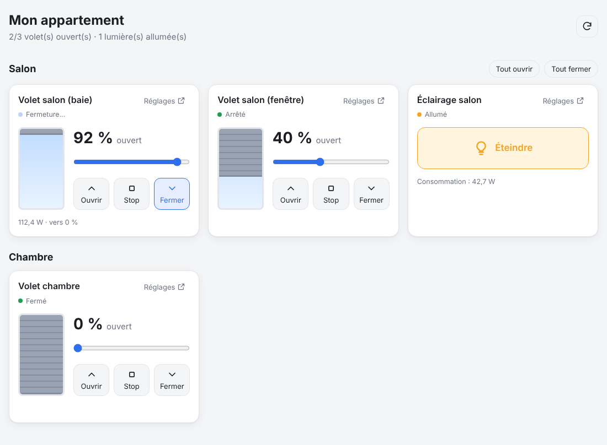

# Domotique – tableau de bord Shelly

Tableau de bord web pour piloter les modules Shelly de l'appartement :

- **3 × Shelly 2PM Gen4** en mode volet (2 au salon, 1 dans la chambre) : état, ouverture, fermeture, stop et position précise (curseur 0–100 %).
- **1 prise connectée** pour l'éclairage du salon : allumer / éteindre, consommation instantanée.
- Un lien **« Réglages »** sur chaque carte ouvre l'interface web du module (plannings, actions, calibration…).
- Boutons **Tout ouvrir / Tout fermer** pour les pièces qui ont plusieurs volets.
- Actualisation automatique (toutes les 3 s, chaque seconde pendant un mouvement), thème clair/sombre, utilisable sur téléphone (ajout possible à l'écran d'accueil).



## Deux versions

| | Version autonome (`standalone/domotique.html`) | Version serveur (`npm start`) |
|---|---|---|
| Installation | Aucune : un seul fichier HTML à ouvrir | Node.js sur une machine allumée en permanence |
| Configuration | Dans l'appli (bouton ⚙), stockée dans le navigateur | Fichier `config.json` |
| Mot de passe sur les modules | Supporté (Gen2+) | Supporté |
| Accès depuis le téléphone | Le fichier doit être ouvert sur chaque appareil | Une simple adresse web, partagée par tous les appareils |

### Version autonome (sans serveur)

1. Téléchargez [`standalone/domotique.html`](standalone/domotique.html) et ouvrez-le dans le navigateur (double-clic).
2. Au premier lancement, la fenêtre **Modules** s'ouvre : renseignez l'adresse IP de chaque module, cliquez sur **Tester** pour vérifier la connexion, puis **Enregistrer**.
3. Utilisez **Exporter / Importer** pour recopier la configuration sur un autre appareil.

Le navigateur dialogue directement avec les modules Gen2+ par **WebSocket** (`ws://<ip>/rpc`), comme l'interface web du module elle-même : ce canal n'est pas soumis aux restrictions CORS des navigateurs, et l'authentification par mot de passe est gérée. Conditions :

- l'appareil doit être sur le **même réseau Wi-Fi** que les modules ;
- si l'authentification est activée sur un module, renseignez son mot de passe dans ⚙ Modules (il est stocké dans le navigateur et inclus dans l'export) ;
- le fichier doit être ouvert **en local** (`file://`) ou depuis un hébergement **http** du réseau local : une page en **https** (GitHub Pages, par ex.) ne peut pas appeler les modules, qui sont en http ;
- les navigateurs récents peuvent demander l'autorisation d'**accéder aux appareils du réseau local** : acceptez ;
- pour une prise Shelly **Gen1**, choisissez le type « Prise Gen1 » et activez l'option CORS dans les réglages de la prise.

## Fonctionnement (version serveur)

```
Navigateur (PC / téléphone) ──► serveur Node.js (ce projet) ──► modules Shelly (Wi-Fi, réseau local)
```

Le serveur tourne sur une machine du réseau local (Raspberry Pi, NAS, PC…) et dialogue avec les modules via leur API HTTP locale (RPC Gen2+). Aucun cloud, aucune dépendance npm : il suffit de **Node.js 18 ou plus récent**.

## Installation

```bash
git clone https://github.com/nabmoloc/Domotique-.git domotique
cd domotique
cp config.example.json config.json
# éditer config.json avec les adresses IP de vos modules
npm start
```

Puis ouvrir `http://<ip-de-la-machine>:8080` depuis n'importe quel appareil du réseau.

> Conseil : attribuez une **adresse IP fixe** à chaque module (réservation DHCP dans votre box), sinon les adresses peuvent changer après un redémarrage.

### Essayer sans matériel

```bash
npm run demo
```

Lance un simulateur de 3 volets et d'une prise, et le tableau de bord sur `http://localhost:8080`.

## Configuration (`config.json`)

```json
{
  "port": 8080,
  "pollInterval": 3000,
  "requestTimeout": 3000,
  "devices": [
    { "id": "volet-salon-1", "name": "Volet salon (baie)", "room": "Salon", "type": "cover", "host": "192.168.1.51" },
    { "id": "lumiere-salon", "name": "Éclairage salon", "room": "Salon", "type": "switch", "host": "192.168.1.54" }
  ]
}
```

| Champ | Description |
|---|---|
| `id` | Identifiant unique (lettres, chiffres, tirets) |
| `name` | Nom affiché |
| `room` | Pièce (regroupe les cartes) |
| `type` | `cover` pour un volet (Shelly 2PM en mode volet), `switch` pour une prise ou un relais |
| `host` | Adresse IP (ou nom d'hôte) du module, éventuellement avec un port |
| `password` | *Optionnel* – mot de passe si l'authentification est activée sur le module |
| `channel` | *Optionnel* – numéro de canal (0 par défaut) |
| `generation` | *Optionnel* – `1` pour un ancien module Shelly Gen1 (ex. Shelly Plug S première génération), `2` par défaut (Plus, Pro, Gen3, Gen4) |
| `webUrl` | *Optionnel* – lien « Réglages » personnalisé (par défaut `http://<host>`) |

Variables d'environnement : `CONFIG` (chemin du fichier de configuration), `PORT`, `HOST`.

### Prérequis côté modules

- Les Shelly 2PM doivent être en **profil « Cover » (volet)**, et **calibrés** pour pouvoir utiliser le curseur de position. Sans calibration, seuls Ouvrir / Stop / Fermer sont disponibles (un message l'indique sur la carte).
- La prise est supposée être une prise **Shelly** (Plug S, Plus Plug S, Plug S Gen3…). Pour une prise d'une autre marque, il faudra ajouter un pilote dans `lib/shelly.js`.

## Lancer au démarrage (Raspberry Pi / Linux)

Créer `/etc/systemd/system/domotique.service` :

```ini
[Unit]
Description=Tableau de bord domotique
After=network-online.target

[Service]
WorkingDirectory=/home/pi/domotique
ExecStart=/usr/bin/node server.js
Restart=always
User=pi

[Install]
WantedBy=multi-user.target
```

Puis : `sudo systemctl enable --now domotique`.

## API

| Méthode | Route | Description |
|---|---|---|
| `GET` | `/api/devices` | État de tous les modules |
| `GET` | `/api/devices/:id` | État d'un module |
| `POST` | `/api/devices/:id/action` | Commande. Corps JSON : `{"action":"open"\|"close"\|"stop"}`, `{"action":"position","position":50}` (volets) ou `{"action":"on"\|"off"\|"toggle"}` (prises) |

## Sécurité

Le tableau de bord n'a pas d'authentification : il est prévu pour rester **sur le réseau local**. Ne l'exposez pas directement sur Internet ; pour un accès à distance, passez par un VPN (WireGuard, Tailscale…).

## Développement

```bash
npm test   # tests (serveur + simulateur, auth Digest comprise)
```

Structure :

- `server.js` – serveur HTTP (API + fichiers statiques)
- `lib/shelly.js` – client Shelly (RPC Gen2+, REST Gen1, auth Digest/Basic)
- `public/` – interface web (HTML/CSS/JS sans framework)
- `standalone/domotique.html` – version autonome, tout-en-un (sans serveur)
- `tools/` – simulateur et mode démo (`npm run simulator` pour tester la version autonome : modules sur `127.0.0.1:9001` à `9004`, le `9003` est protégé par le mot de passe `demo`, sauf si `SIM_PASSWORD=` est défini vide ; `SIM_NO_CORS=1` simule des modules qui refusent les appels HTTP depuis une page web)
